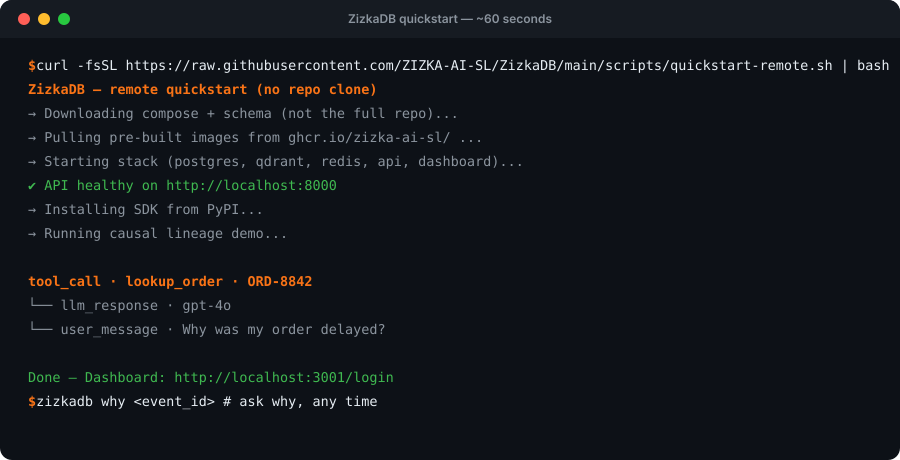
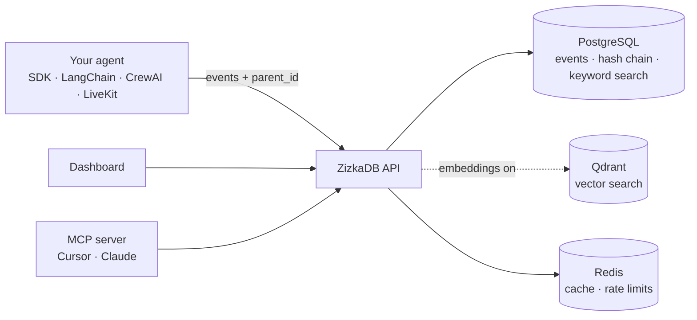

<div align="center">

<a href="https://db.zizka.ai"></a>

# ZizkaDB

### The Operational database for Auditing, Memory and Compliance for AI Agents

Every step linked to its cause, every record **provably untouched**, every past state replayable.<br/>
**Hash-chained audit trail** for **EU AI Act Article 12** · **memory that works without OpenAI** · **time-travel debugging**

Keyword + vector search · Drift detection · MCP server · Python & TypeScript SDKs · Self-host or cloud

**[Quickstart](#quickstart-60-seconds)** · **[Docs](DEVELOPMENT.md)** · **[Integrations](#integrations)** · **[Connect](CONNECT.md)** · **[Cloud](https://db.zizka.ai)** · **[Discussions](https://github.com/ZIZKA-AI-SL/ZizkaDB/discussions)** · **[Contributing](CONTRIBUTING.md)**

[](https://github.com/ZIZKA-AI-SL/ZizkaDB/actions/workflows/ci.yml)
[](LICENSE)
[](https://github.com/ZIZKA-AI-SL/ZizkaDB/releases)
[](https://pypi.org/project/zizkadb-sdk/)
[](https://www.npmjs.com/package/zizkadb-sdk)
[](https://github.com/ZIZKA-AI-SL/ZizkaDB/stargazers)
[](https://pepy.tech/projects/zizkadb-sdk)
[](https://www.npmjs.com/package/zizkadb-sdk)

<a href="https://postyourstartup.co/startup/zizkadb-1?ref=award" target="_blank"></a>

</div>

Every agent team eventually asks: *Why did it say that? Why did it call that tool?* ZizkaDB links every agent step to the step that caused it, so you get the answer in one call instead of scrolling through traces.

- **Causal, not just traces.** Each event carries a `parent_id`. `db.why(event_id)` walks back to the user message, wrong tool, or bad context that started it.
- **Time-travel.** `db.at(agent, timestamp)` rebuilds exactly what the agent knew at any past moment.
- **Provable history.** Every event has a checksum and is hash-chained to the one before it, so `db.verify_chain(agent)` proves nothing was edited, removed or reordered. GDPR deletions leave a content-free tombstone. A verifiable record for EU AI Act Article 12.
- **Memory for the next run.** `db.context_for(agent, task)` returns the relevant past as a prompt block, ranked by relevance, importance and recency; a new fact can replace an old one (`supersedes`). Keyword search works with no OpenAI key, hybrid with embeddings, or embed locally.
- **Built like a database.** Idempotent and batch writes, retention, export/import, read-only and expiring keys, Prometheus metrics, backup and restore scripts.
- **Drift detection.** See when an agent's behavior shifts from its baseline.
- **Self-host or cloud.** Run it on your own Postgres with one Docker command, or use [ZizkaDB Cloud](https://db.zizka.ai). AGPL-3.0, no per-trace billing; self-hosted data never leaves your infrastructure. Self-hosted runs **one agent with one API key**; multiple agents, agent fleets and agent-to-agent messaging are on Cloud.

**In plain words:** ZizkaDB is a flight recorder for AI agents. It records every step an agent takes and which step led to it, so when an agent does something unexpected, you can see exactly why.

### Start here

| You are… | Go to |
| --- | --- |
| New to ZizkaDB, or not technical | [ZizkaDB Cloud](https://db.zizka.ai): nothing to install |
| A developer trying it on your laptop | [Quickstart](#quickstart-60-seconds): one command, about a minute |
| Adding it to an agent you already have | [Connect your agent](#connect-your-agent) |
| Running it for your team on a server | [Self-host on a server](#self-host-on-a-server) or [Deploy on Redu Cloud](#deploy-on-redu-cloud) |

<p align="center">
  <a href="#quickstart-60-seconds"></a>
</p>

## Contents

- [Quickstart (60 seconds)](#quickstart-60-seconds)
  - [Self-host on a server](#self-host-on-a-server) · [Deploy on Redu Cloud](#deploy-on-redu-cloud)
- [Integrations](#integrations)
- [Connect your agent](#connect-your-agent)
- [What it does](#what-it-does)
- [Audit trail and EU AI Act Article 12](#audit-trail-and-eu-ai-act-article-12)
- [How it works](#how-it-works)
- [Use with your AI assistant (MCP)](#use-with-your-ai-assistant-mcp)
- [ZizkaDB vs. tracing tools](#zizkadb-vs-tracing-tools)
- [Cloud, FAQ and docs](#more)
- [Contributors](#contributors)

---

## Quickstart (60 seconds)

One command, one container. No repo clone, no Python, no config files.

<p align="center">
  <a href="scripts/quickstart-remote.sh"></a>
</p>

**1. Run it.** With [Docker](https://docs.docker.com/get-docker/) running:

```bash
curl -fsSL https://raw.githubusercontent.com/ZIZKA-AI-SL/ZizkaDB/main/scripts/quickstart-remote.sh | bash
```

This pulls a single image (Postgres, the API and the dashboard together), starts it, and logs a demo agent run. After the download, startup takes a few seconds.

**2. See why.** It prints the causal chain behind the demo agent's tool call:

```text
tool_call · lookup_order · ORD-8842
  └── llm_response · gpt-4o
        └── user_message · Why was my order delayed?
```

**3. Explore.** The dashboard opens on that agent, already signed in: [localhost:3001/dashboard/activity?agent=support-bot](http://localhost:3001/dashboard/activity?agent=support-bot). Click any event → **Why? (causal)** tab.

Now log your own agent: `pip install zizkadb-sdk`, then see [CONNECT.md](CONNECT.md). The local API is `http://localhost:8000` with key `zizkadb_dev_local`.

<details>
<summary>Prefer plain <code>docker run</code>? Day-two commands</summary>

The script is a wrapper around this:

```bash
docker run -d --name zizkadb -e ENV=development \
  -p 127.0.0.1:8000:8000 -p 127.0.0.1:3001:3001 \
  -v zizkadb_data:/data ghcr.io/zizka-ai-sl/zizkadb
```

| Do this | Command |
|---------|---------|
| Stop / start | `docker stop zizkadb` / `docker start zizkadb` |
| Logs | `docker logs -f zizkadb` |
| Upgrade (keeps data) | re-run the quickstart command |
| Erase everything | `docker rm -f zizkadb && docker volume rm zizkadb_data` |
| Dashboard port busy | `ZIZKADB_DASHBOARD_PORT=3005` before the quickstart command |

</details>

The single container has two modes:

- **On your own machine** (`-e ENV=development`, what the quickstart uses): one-click sign-in and a well-known API key, with the ports bound to `127.0.0.1` only.
- **On a server** (the default, production mode): the container generates its own secrets on first start, and the dashboard and API share port 3001. Sign in with the admin token:

  ```bash
  docker run -d --name zizkadb -p 3001:3001 -v zizkadb_data:/data ghcr.io/zizka-ai-sl/zizkadb
  docker exec zizkadb sed -n 's/^GEN_SELFHOST_ADMIN_TOKEN=//p' /data/secrets.env   # your admin token
  ```

  Put it behind HTTPS, and set `ZIZKADB_PUBLIC_URL=https://your-domain` so the links it generates are correct. If a reverse proxy on the same host forwards to it, add `-e TRUSTED_PROXIES=127.0.0.1,::1,172.16.0.0/12` so sign-in rate limits see each visitor.

The single container runs without Qdrant: search and `context_for()` use keyword search there (no setup, no OpenAI key). For vector search, use the full stack below with embeddings on.

The self-hosted dashboard is just your dashboard: no signup, no email, no account. Accounts and plans exist only on [ZizkaDB Cloud](https://db.zizka.ai).

Self-hosted is single-agent: the first agent name you log with becomes your agent, and a second name is rejected with a message naming it. The `support-bot` demo agent does not count. For several agents, use [ZizkaDB Cloud](https://db.zizka.ai).

### Self-host from a clone

The full stack (Postgres, Qdrant, Redis, API, dashboard as separate containers) — use this for development, vector search, or production. It generates random database, Redis and Qdrant passwords on first setup:

```bash
git clone https://github.com/ZIZKA-AI-SL/ZizkaDB.git && cd ZizkaDB
bash scripts/setup-local.sh
```

| Service | URL |
|---------|-----|
| API | http://localhost:8000 |
| Dashboard | http://localhost:3001 |
| Swagger | http://localhost:8000/swagger |

### Self-host on a server

On a machine other people can reach:

```bash
cp .env.example infra/.env
bash scripts/init-secrets.sh        # random Postgres, Redis, Qdrant and JWT secrets
```

Then set these in `infra/.env` before starting the stack:

```bash
ENV=production                      # turns off the one-click button and dev API keys
DEV_API_KEY=<random>                # must not be the default, or the API refuses to start
DEPLOYMENT_MODE=self_hosted
SELFHOST_ADMIN_TOKEN=<long-random>  # python -c "import secrets; print(secrets.token_urlsafe(32))"
```

Optional: `EVENT_RETENTION_DAYS` (delete old events), `METRICS_TOKEN` (Prometheus `/metrics`), `REDACT_PATTERNS` (redact emails, phones, cards before storage). Data ports stay on `127.0.0.1`.

The dashboard then asks for the admin token instead of showing the one-click button. Without `SELFHOST_ADMIN_TOKEN`, dashboard login stays disabled. Everyone who has the token signs in to the same single owner workspace. Check your config with `bash scripts/validate-selfhost-config.sh --production`. Full steps: [wiki/Self-Hosting](https://github.com/ZIZKA-AI-SL/ZizkaDB/wiki/Self-Hosting).

### Deploy on Redu Cloud

[](redu.md)

[Redu Cloud](https://redu.cloud) is ZizkaDB's recommended cloud for the open-source edition. With the redu MCP added to your coding agent, ask it to "Deploy https://github.com/ZIZKA-AI-SL/ZizkaDB to redu". The agent follows [redu.md](redu.md): the single container on one VM, the dashboard and API on one HTTPS URL, and your data kept in a volume. Then sign in with the admin token, create your API key in Settings, and set `ZIZKADB_HOST` and `ZIZKADB_API_KEY` in your agent.

Full guide: **[DEVELOPMENT.md](DEVELOPMENT.md)** · Troubleshooting: [wiki/Troubleshooting.md](wiki/Troubleshooting.md) · What ZizkaDB sends: [docs/telemetry.md](docs/telemetry.md)

---

## Integrations

Works with the stack you already use — add one package and every step is logged with its cause.

<p align="center">
  <a href="CONNECT.md"></a> &nbsp;&nbsp; <a href="CONNECT.md"></a> &nbsp;&nbsp; <a href="CONNECT.md#langchain"></a> &nbsp;&nbsp; <a href="CONNECT.md#crewai"></a> &nbsp;&nbsp; <a href="CONNECT.md#livekit-agents-voice"></a> &nbsp;&nbsp; <a href="mcp/README.md"></a> &nbsp;&nbsp; <a href="https://db.zizka.ai/swagger"></a>
</p>

<table>
  <tr><th>Integration</th><th>Install</th><th>What you get</th></tr>
  <tr>
    <td nowrap>&nbsp;<a href="CONNECT.md"><strong>Python</strong></a></td>
    <td><code>pip install zizkadb-sdk</code></td>
    <td>Any Python agent</td>
  </tr>
  <tr>
    <td nowrap>&nbsp;<a href="CONNECT.md"><strong>TypeScript</strong></a></td>
    <td><code>npm install zizkadb-sdk</code></td>
    <td>Any JavaScript / TypeScript agent</td>
  </tr>
  <tr>
    <td nowrap>&nbsp;<a href="CONNECT.md#langchain"><strong>LangChain</strong></a></td>
    <td><code>pip install zizkadb-langchain</code></td>
    <td>Drop-in callback handler</td>
  </tr>
  <tr>
    <td nowrap>&nbsp;<a href="CONNECT.md#crewai"><strong>CrewAI</strong></a></td>
    <td><code>pip install zizkadb-crewai</code></td>
    <td>Crew logger for your agents</td>
  </tr>
  <tr>
    <td nowrap>&nbsp;<a href="CONNECT.md#livekit-agents-voice"><strong>LiveKit</strong></a></td>
    <td><code>pip install zizkadb-livekit</code></td>
    <td>Voice agents — one call, one session</td>
  </tr>
  <tr>
    <td nowrap>&nbsp;<a href="mcp/README.md"><strong>MCP</strong></a></td>
    <td><code>uvx zizkadb-mcp</code></td>
    <td>Ask Cursor or Claude why</td>
  </tr>
  <tr>
    <td nowrap>&nbsp;<a href="https://db.zizka.ai/swagger"><strong>REST API</strong></a></td>
    <td><a href="https://db.zizka.ai/swagger">Swagger docs</a></td>
    <td>Any language</td>
  </tr>
</table>

Click a name for its setup guide. New project? Scaffold one with `zizkadb init my-agent --template basic`.

---

## Connect your agent

```python
import asyncio
from zizkadb import ZizkaDB

async def main():
    async with ZizkaDB(host="http://localhost:8000") as db:
        user = await db.log(agent="my-bot", event="user_message", data={"text": "Why is my order late?"})
        tool = await db.log(agent="my-bot", event="tool_call", data={"tool": "lookup_order"}, parent_id=user.event_id)
        (await db.why(tool.event_id)).print()

asyncio.run(main())
```

<details>
<summary><strong>TypeScript</strong></summary>

```ts
import { ZizkaDB } from 'zizkadb-sdk'

const db = new ZizkaDB({ host: 'http://localhost:8000' })

const user = await db.log({ agent: 'my-bot', event: 'user_message', data: { text: 'Why is my order late?' } })
const tool = await db.log({ agent: 'my-bot', event: 'tool_call', data: { tool: 'lookup_order' }, parentId: user.eventId })
;(await db.why(tool.eventId)).print()
```

</details>

From the terminal: `zizkadb why <event_id>`. Full guide: **[CONNECT.md](CONNECT.md)**

---

## What it does

| | Function | What you get |
| --- | --- | --- |
| **Debug** | `db.why(event_id)` | The causal chain behind any event |
| | `db.at(agent, timestamp)` | What the agent knew at a past moment |
| | `db.baseline(agent)` | Drift detection: alerts when behavior shifts from past sessions |
| **Remember** | `db.context_for(agent, task)` | Relevant past events as a prompt block (relevance × importance × recency) |
| | `db.search(query, mode=)` | Keyword search out of the box; hybrid keyword + vector with embeddings |
| | `db.log(..., supersedes=, importance=)` | Replace an outdated fact; weight what matters |
| **Audit** | `db.verify_chain(agent)` | Proof that no event was edited, removed or reordered |
| | `db.forget(key, value)` | GDPR erasure, including the search index, leaving a tombstone |
| | `db.export_events(agent)` / `db.import_events(...)` | Portable NDJSON copy; move between self-host and Cloud |
| **Operate** | `db.log(..., idempotency_key=)` / `db.log_batch(events)` | Safe retries; up to 500 events per request |
| | `db.iter_events(agent)` | Every event, cursor-paged |
| | Server settings | Retention, redaction, read-only and expiring keys, `/metrics`, backup and restore |

### Audit trail and EU AI Act Article 12

Article 12 of the EU AI Act requires high-risk AI systems to automatically keep logs of what they did. ZizkaDB gives you that record:

- **Checksum-backed decision logs.** Every event is stored with a SHA-256 checksum over its content and audit fields (agent, session, parent, timestamp, sequence), and `GET /v1/events/verify` reports any row whose fields no longer match. Events are also hash-chained per agent, so `GET /v1/events/chain` proves no event was removed, inserted or reordered (GDPR deletions leave a content-free tombstone).
- **Causally linked history.** Each decision points to the event that caused it, so an auditor can follow the full chain.
- **Session replay.** Step through any past session event by event.
- **Time-travel debugging.** Rebuild exactly what the agent knew at any moment with `db.at()`.
- **Drift detection.** `db.baseline()` flags when an agent starts behaving differently from its history.

ZizkaDB supports your record-keeping obligations; it doesn't make a system compliant on its own.

<p align="center">
  <a href="https://db.zizka.ai"></a>
</p>

---

## How it works



- **Postgres is the source of truth.** Every event stores its parent (`why()` is one recursive query), its checksum and its link in the agent's hash chain. Keyword search is Postgres full-text search, so search works with nothing else installed.
- **Qdrant is optional.** With embeddings on (OpenAI or a local model), events are also indexed for vector search, and search becomes hybrid. Design decisions: [docs/adr/](docs/adr/).

---

## Use with your AI assistant (MCP)

Ask Cursor or Claude *"why did support-bot call lookup_order?"* and get the chain back. Add this to your MCP config:

```json
{
  "mcpServers": {
    "zizkadb": {
      "command": "uvx",
      "args": ["zizkadb-mcp"],
      "env": { "ZIZKADB_HOST": "http://localhost:8000" }
    }
  }
}
```

For ZizkaDB Cloud, use `ZIZKADB_API_KEY` instead. Setup for each client: [mcp/README.md](mcp/README.md). The MCP server is MIT-licensed; everything else is AGPL-3.0 ([NOTICE](NOTICE)).

---

## ZizkaDB vs. tracing tools

Tools like Langfuse and LangSmith **observe** span trees. ZizkaDB **audits** decisions.

| | ZizkaDB | Typical LLM tracing tools |
| --- | :---: | :---: |
| Explicit cause → effect links | ✅ | Span nesting |
| One-call root cause (`db.why()`) | ✅ | Manual trace reading |
| Time-travel to past agent state | ✅ | — |
| Memory for future runs (`db.context_for()`) | ✅ | — |
| Tamper-evident hash chain, verifiable in one call | ✅ | — |
| GDPR erasure that leaves proof (tombstones) | ✅ | — |
| Self-host search with no LLM key | ✅ | — |
| Pricing | Free self-host (AGPL) | Often per-trace |

---

<a id="more"></a>

<details>
<summary><strong>Managed cloud (Pro / Team)</strong></summary>

The same features, hosted at [db.zizka.ai](https://db.zizka.ai). No Docker to maintain.

| | **Pro** | **Team** |
| --- | --- | --- |
| Price | €29 / mo | €69 / mo |
| Events / mo† | 50k | 100k |
| API keys | 2 | 5 |

[Sign up →](https://db.zizka.ai/signup/plan)

† Plan targets on managed cloud; not enforced in API yet. See [docs/README.md](docs/README.md#plan-limits-honest).

</details>

<details open>
<summary><strong>FAQ</strong></summary>

**Do I need to clone this repo?**  
No. The curl quickstart downloads config and Docker images only.

**Do I need an API key locally?**  
No. `http://localhost:8000` uses a built-in dev key.

**Do I need an OpenAI key?**  
No. Logging, `why()`, time travel, keyword search and `context_for()` work without one. Add an OpenAI key, or run a local embedding model (`EMBEDDINGS_PROVIDER=local` with Ollama, LM Studio or vLLM), for hybrid vector search.

**How do I prove the logs weren't changed?**  
`db.verify_chain(agent)` (or `GET /v1/events/chain`) rechecks every checksum and link and returns the chain head. Store the head somewhere else; checking again later from that head proves nothing before it was rewritten.

**My server's login page asks for an admin token. Where is it?**  
A server install generates one on first start. Single container: `docker exec zizkadb sed -n 's/^GEN_SELFHOST_ADMIN_TOKEN=//p' /data/secrets.env`. Full stack: the `SELFHOST_ADMIN_TOKEN` you set in `infra/.env`. After signing in, create your API key in **Settings**.

**Where does my data go?**  
When you self-host, everything stays on your machine. The server and dashboard make no outside requests; the SDKs send one anonymous install ping, which `ZIZKADB_TELEMETRY=false` turns off. Details: [docs/telemetry.md](docs/telemetry.md).

**`zizkadb demo` says connection refused?**  
The stack isn't running. Start it with the curl command above or `bash scripts/setup-local.sh`.

</details>

<details>
<summary><strong>Docs & community</strong></summary>

| | |
| --- | --- |
| Worked example | [worked/01-support-order-delay](worked/01-support-order-delay/) |
| Examples | [examples/](examples/) |
| Self-hosting | [DEVELOPMENT.md](DEVELOPMENT.md) · [wiki/Self-Hosting](https://github.com/ZIZKA-AI-SL/ZizkaDB/wiki/Self-Hosting) |
| Integrate any agent | [docs/integrate/](docs/integrate/) |
| Issues · Discussions | [Issues](https://github.com/ZIZKA-AI-SL/ZizkaDB/issues) · [Discussions](https://github.com/ZIZKA-AI-SL/ZizkaDB/discussions) |
| Security | [SECURITY.md](SECURITY.md) |
| AI-assisted development | [AGENTS.md](AGENTS.md) |

</details>

---

## Contributors

Thanks to everyone who has helped build ZizkaDB. Want to join? Read [CONTRIBUTING.md](CONTRIBUTING.md) or pick up an [open issue](https://github.com/ZIZKA-AI-SL/ZizkaDB/issues).

<!-- CONTRIBUTORS:START -->
<table>
  <tr>
    <td align="center" width="25%"><a href="https://github.com/saadamjad"><br/><sub>saadamjad</sub></a></td>
    <td align="center" width="25%"><a href="https://github.com/Zizka-ai"><br/><sub>Zizka-ai</sub></a></td>
    <td align="center" width="25%"><a href="https://github.com/arshadgit23"><br/><sub>arshadgit23</sub></a></td>
    <td align="center" width="25%"><a href="https://github.com/rajandevkota98"><br/><sub>rajandevkota98</sub></a></td>
  </tr>
  <tr>
    <td align="center" width="25%"><a href="https://github.com/Subhajitdas99"><br/><sub>Subhajitdas99</sub></a></td>
    <td align="center" width="25%"><a href="https://github.com/saadwashmen"><br/><sub>saadwashmen</sub></a></td>
    <td align="center" width="25%"><a href="https://github.com/mikeaig4real"><br/><sub>mikeaig4real</sub></a></td>
    <td align="center" width="25%"><a href="https://github.com/aqilaziz"><br/><sub>aqilaziz</sub></a></td>
  </tr>
  <tr>
    <td align="center" width="25%"><a href="https://github.com/pingkui"><br/><sub>pingkui</sub></a></td>
    <td align="center" width="25%"><a href="https://github.com/AIandI0x1"><br/><sub>AIandI0x1</sub></a></td>
    <td align="center" width="25%"><a href="https://github.com/lamenting-hawthorn"><br/><sub>lamenting-hawthorn</sub></a></td>
    <td align="center" width="25%"><a href="https://github.com/nabeeltahirdeveloper"><br/><sub>nabeeltahirdeveloper</sub></a></td>
  </tr>
  <tr>
    <td align="center" width="25%"><a href="https://github.com/abdurrehman616"><br/><sub>abdurrehman616</sub></a></td>
    <td align="center" width="25%"><a href="https://github.com/danielhagever"><br/><sub>danielhagever</sub></a></td>
    <td align="center" width="25%"><a href="https://github.com/eaz1337"><br/><sub>eaz1337</sub></a></td>
    <td align="center" width="25%"><a href="https://github.com/HafizHamzaShahid"><br/><sub>HafizHamzaShahid</sub></a></td>
  </tr>
  <tr>
    <td align="center" width="25%"><a href="https://github.com/mbilalzeeshan"><br/><sub>mbilalzeeshan</sub></a></td>
    <td align="center" width="25%"><a href="https://github.com/nabeeltahirpsy"><br/><sub>nabeeltahirpsy</sub></a></td>
    <td align="center" width="25%"><a href="https://github.com/AbdelazizBs"><br/><sub>AbdelazizBs</sub></a></td>
    <td align="center" width="25%"><a href="https://github.com/Mephistopheles9631"><br/><sub>Mephistopheles9631</sub></a></td>
  </tr>
  <tr>
    <td align="center" width="25%"><a href="https://github.com/Qalbeabbas-12"><br/><sub>Qalbeabbas-12</sub></a></td>
    <td align="center" width="25%"><a href="https://github.com/towfiq-ul"><br/><sub>towfiq-ul</sub></a></td>
  </tr>
</table>
<!-- CONTRIBUTORS:END -->

---

<p align="center">
  <sub>AGPL-3.0 · MCP server MIT · Disable telemetry: <code>export ZIZKADB_TELEMETRY=false</code><br/>
  This repo is the open-source self-host stack. The operator console and VPC deploy live in a private repo (<a href="docs/REPO_SPLIT.md">why</a>).</sub>
</p>
